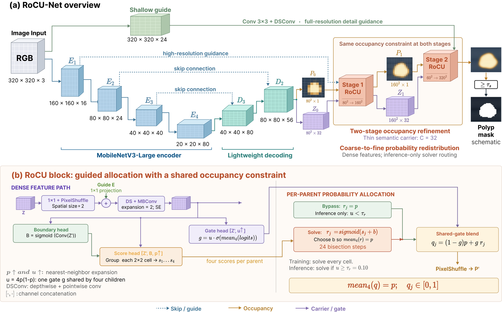
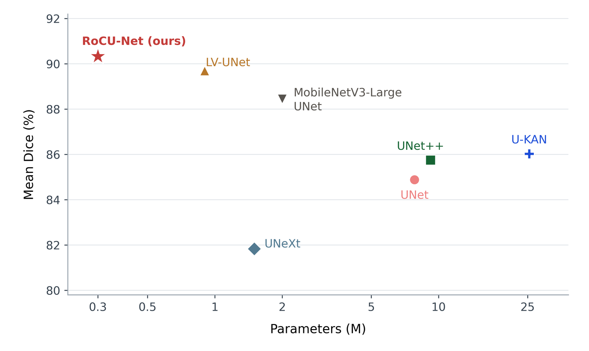
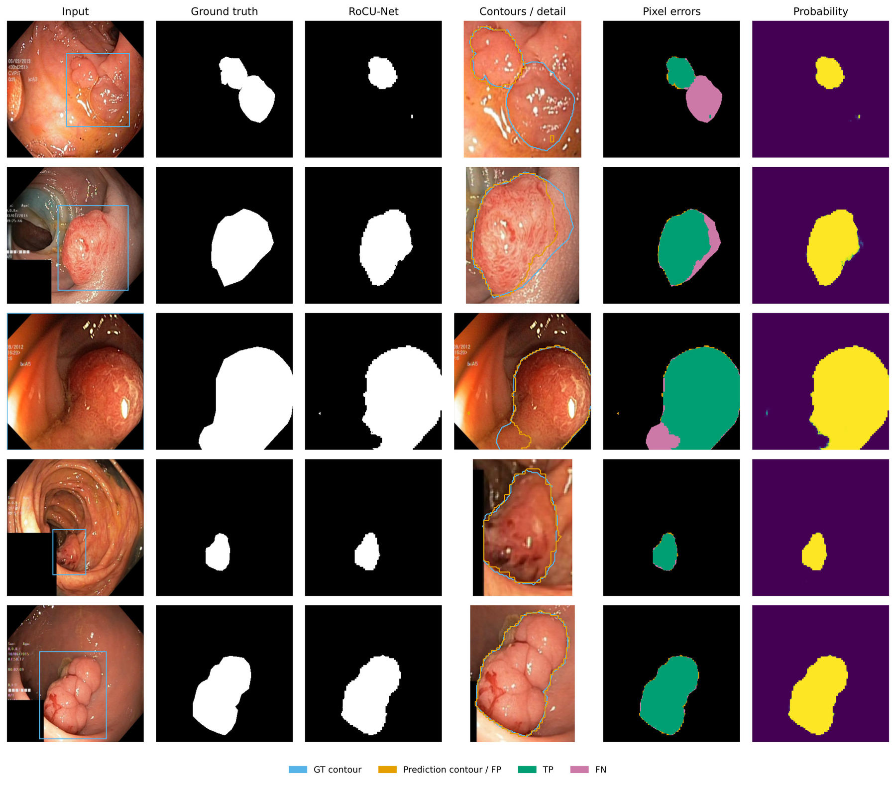

# RoCU-Net: Routed Occupancy-Constrained Upsampling for Lightweight Polyp Segmentation

**Hai-Dang Nguyen, Tran-Quoc Duy Nguyen, Hoai-Thuong Dang, Xuan-Nam Cao**
University of Science, VNU-HCM, Ho Chi Minh City, Vietnam

*ICAART 2027*  ·  [Project page](https://danielnguyen-05.github.io/RoCU-Net/)

Official PyTorch implementation of **RoCU-Net**, a lightweight encoder–decoder
network for polyp segmentation in colonoscopy images.

<p align="center">
  
</p>

Lightweight decoders tend to lose boundary detail in their final upsampling
steps. RoCU-Net treats a coarse prediction as a **local foreground occupancy**
and redistributes it among the four child cells at the next resolution so that
their mean matches the parent. Each **RoCU** (Routed Occupancy-Constrained
Upsampling) stage combines:

- **Occupancy-constrained allocation**: four child scores are shifted by one
  shared offset `b`, found by bisection, so that `mean_j sigmoid(s_j + b) = p`.
- **A compact semantic carrier** (32 channels) that is propagated across both
  high-resolution transitions and guides the allocation together with encoder
  and shallow-image features.
- **Shared-gate blending**: `q_j = (1 - g) p + g r_j`, where one gate
  `g = 4p(1-p) · ĝ` is shared by the four children. The parent–child mean is
  preserved for any value of `g`.
- **Confidence routing at inference**: cells with `4p(1-p) < τr` bypass the
  iterative solver. Carrier convolutions and the prediction heads remain dense.

## Results

| Dataset | Dice | IoU |
|---|---:|---:|
| CVC-ClinicDB | 0.9102 | 0.8506 |
| CVC-ColonDB | 0.8969 | 0.8301 |
| Kvasir-SEG | 0.9028 | 0.8358 |

| Parameters | FLOPs | Latency (RTX 4060 Ti, batch 1, FP32) |
|---:|---:|---:|
| 0.28M | 1.12G | 10.40 ms / image (96.17 FPS) |

<p align="center">
  
</p>

Qualitative results on the Kvasir-SEG test set:

<p align="center">
  
</p>

## Installation

Python 3.10+ and PyTorch 2.2+ are recommended.

```bash
git clone https://github.com/DanielNguyen-05/RoCU-Net.git
cd RoCU-Net
python -m venv .venv
source .venv/bin/activate        # Windows: .venv\Scripts\activate
pip install -r requirements.txt
```

Install the PyTorch build that matches your CUDA version from
[pytorch.org](https://pytorch.org/get-started/locally/). The encoder is
initialised from the ImageNet-pretrained torchvision MobileNetV3-Large weights,
which are downloaded on first use. Set `model.pretrained: false` in a config to
train offline.

## Datasets

Download the datasets from their official sources and place them under
`dataset/`. Images and masks are paired by filename stem, so their extensions
may differ.

```text
dataset/
├── Kvasir-SEG/
│   ├── images/
│   └── masks/
├── CVC-ClinicDB/
│   └── PNG/
│       ├── Original/
│       └── Ground Truth/
└── CVC-ColonDB/
    ├── images/
    └── masks/
```

The first run of each config writes its train/validation/test manifests to
`runs/<experiment>/splits/` and reuses them afterwards. To reuse fixed
manifests, set `data.split_source` to a directory containing `train.csv`,
`val.csv` and `test.csv`.

## Training and evaluation

```bash
# Kvasir-SEG
python train.py --config configs/kvasir.yaml --device cuda

# CVC-ClinicDB
python train.py --config configs/cvc_clinicdb.yaml --device cuda

# CVC-ColonDB (initialised from the Kvasir-SEG checkpoint, flip TTA at inference)
python train.py --config configs/cvc_colondb.yaml --device cuda
```

Each run is saved under `runs/<experiment>/` (checkpoints, resolved config,
splits, training history, validation/test metrics and per-image results).
Training evaluates the selected checkpoint on the test split when it finishes.

Resume an interrupted run:

```bash
python train.py --config configs/kvasir.yaml \
  --resume runs/rocu_kvasir_seed42/last.pt --device cuda
```

Evaluate a checkpoint:

```bash
python evaluate.py --checkpoint runs/rocu_kvasir_seed42/best.pt \
  --split test --save-predictions --device cuda
```

Predict a single image or a directory (probability maps, binary masks and
overlays at the original resolution):

```bash
python predict.py --checkpoint runs/rocu_kvasir_seed42/best.pt \
  --input /path/to/images --output predictions --device cuda
```

Reported metrics include Dice, IoU, precision, recall, specificity, accuracy,
F2, MAE, Boundary F1 (2-pixel tolerance) and the cross-scale occupancy
conservation error.

## Repository structure

```text
rocu_net/        model (RoCU block), data pipeline, losses, metrics, training engine
configs/         configs for Kvasir-SEG, CVC-ClinicDB and CVC-ColonDB
assets/          figures used in this README
website/         project page
train.py         training (+ test evaluation of the selected checkpoint)
evaluate.py      evaluation of a checkpoint on a split
predict.py       inference on an image or a directory
```

## Citation

If you find this work useful, please cite:

```bibtex
@inproceedings{NguyenICAART2027,
  title = {{RoCU-Net}: Routed Occupancy-Constrained Upsampling for Lightweight Polyp Segmentation},
  author = {Nguyen, Hai-Dang and Nguyen, Tran-Quoc Duy and Dang, Hoai-Thuong and Cao, Xuan-Nam},
  booktitle = {International Conference on Agents and Artificial Intelligence (ICAART)},
  year = {2027},
}
```

## Contact

For questions, please open an issue or contact Hai-Dang Nguyen
(nhdang231@clc.fitus.edu.vn).
